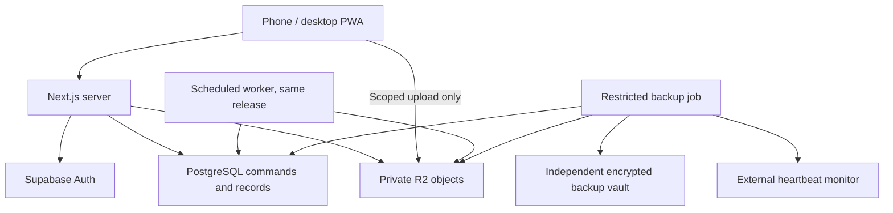

# Crest OS V1 - Technical Architecture

Version: 1.7 | 2026-10-25 | ADR42 explicit unresolved nonfinancial-operation retirement; production gated

Calendar scope amendment, 2026-10-22: the owner requested Google Calendar connection support in V1. P20/BR21/ADR35 now require the capability with optional owner activation, outbound-only projection and unchanged integrity/security/recovery gates. This supersedes older optional/excluded Calendar wording only. Current versions and immutable-baseline amendment evidence are in CANONICAL_MAINTENANCE.md; implementation/research and unexecuted provider gates are in [the Calendar contract](../planning/GOOGLE_CALENDAR_V1.md). No live integration or production approval is implied.

Public edition, 2026-10-20: owner-authorized public source; application access and business evidence remain private. PUBLICATION.md records this explicit privacy/provenance amendment and the current authority/version register. Earlier private-repository and budget/authorization statements below are historical where superseded there. No security, accounting, recovery or real-data activation gate is waived.

## 1. Authority and readiness

Read with PRODUCT.md1.5, BUSINESS_RULES.md1.4 and ACCOUNTING.md1.5 (current version register in PUBLICATION.md), plus the contextual CREST_CONTEXT.md. Their P01-P20, BR00-BR21 and activation gates remain mandatory. This package defines technical decisions; it does not approve tax policy, insurance coverage, migration balances, funding, or production activation. The original architecture phase created no repository, application, migration or infrastructure. Phase 1 repository/tooling work is now owner-authorized. ACCOUNTING.md is adopted as the specialized financial contract, including sections 24-26; its X01-X28 amendments are incorporated in the canonical companions. See CANONICAL_MAINTENANCE.md for the preserved baseline and this revision.

Companion contracts: DATABASE.md, SECURITY.md, TESTING.md, EXPORTS_AND_BACKUPS.md, ROADMAP.md and ARCHITECTURE_DECISIONS.md. Adopt these together. ARCHITECTURE_REVIEW.md records the final failure scenarios, ratings and complete requirement/gate reconciliation. Engineering may choose local names and minor UI details, but changing transaction boundaries, posting contracts, isolation, storage guarantees or providers requires an ADR update.

The reconciled product/rules preserve approved V1 scope. Accounting contradictions are corrected in the companion bodies. Two general immutability rules remain: an immutable financial document may have a separately recorded reversal lifecycle event; this never edits its posted fields. A credit does not replenish consumed commercial scope; replacement billing requires an explicit correction link and net entitlement validation. These interpretations implement BR06/BR11 rather than relax them.

Ready for repository creation, nonfinancial implementation and synthetic financial implementation under the adopted contracts. Production remains blocked by actual configuration/openings and executed release, security, recovery and pilot evidence. No repository or implementation is created by this reconciliation.

## 2. Recommended system shape

Use one TypeScript modular monolith, Next.js App Router on the standard Node.js runtime, managed PostgreSQL and Auth on Supabase, private Cloudflare R2 objects, and a conventional Docker deployment on Render. A scheduled worker runs the same release image with a different entry point. PostgreSQL holds durable queued work; there is no Redis, event broker, microservice mesh or separate API application.

Cloudflare remains suitable for DNS and object storage. Do not make the application depend on Workers runtime APIs. Official Next.js deployment supports Node/Docker. Cloudflare currently recommends vinext for new Next.js-on-Workers projects and retains an OpenNext adapter path. That compatibility layer is unnecessary for a one-owner application requiring PostgreSQL utilities, image validation and streaming financial exports. Choosing standard Node is a maintainability decision, not a claim that Workers cannot host Next.js. [S01, S02]

## 3. Stack and deployment contract

| Component | Selection | Reason and limits |
|---|---|---|
| UI/server | Next.js, React, TypeScript strict; standard Node runtime | One deployment and shared types; server-only domain access; no edge-only dependency |
| Runtime packaging | Supported Node LTS, pinned container image digest and lockfile | Portable Docker build; exact versions selected and recorded at repository foundation after compatibility/security checks |
| Database | Supabase Free production pilot, PostgreSQL; quota/recovery gated | Transactions, constraints, row locks, RLS, portable SQL; one business now |
| Query layer | node-postgres (`pg`) with parameterized SQL and generated database types | Direct transaction control; SQL visible for ledger and locking; no ORM schema push |
| Migrations | Ordered SQL files through Supabase CLI migration workflow | One migration authority, reviewed SQL, checksums recorded; no dashboard schema edits |
| Identity | Supabase Auth password + TOTP; server-held provider sessions | No custom password verifier; application session registry closes revocation/timeout gaps |
| Objects | R2 Standard, private buckets, S3 SDK | Immutable original keys, explicit metadata, portable object API; independent backup needed |
| Hosting | Render paid always-on Node/Docker web service; US East near DB | Start with Starter only if measured resource gates pass; Standard is the predetermined memory upgrade |
| Scheduled execution | Render cron entry points from same image | General queue tick every minute; dedicated backup schedule; durable leases in DB |
| Reports | PDFKit, ExcelJS streaming writer, streaming CSV | No headless browser runtime required for PDFs; deterministic layout and exact control totals |
| Images | sharp/libvips, sandboxed validation; patched HEIC decoder in worker image | Preserve originals; separate previews; HEIC support must pass real-device fixtures |
| Tests | Vitest, PostgreSQL/pgTAP, Playwright, axe-core, k6 | Pure rules, direct database invariants, workflow/security/mobile and load gates |
| Source/CI | Private GitHub repository and GitHub Actions | Protected main, immutable build artifact, explicit production release; CI is not the sole backup scheduler |
| Monitoring | Redacted structured logs + application health events; Healthchecks.io heartbeat | No mandatory third-party session replay or customer-data telemetry |
| Recovery | pg_dump/pg_restore; encrypted immutable objects in independent Backblaze B2 account | Retention and restore verification independent of app credentials/provider backups |
| Auth mail | Resend SMTP on verified Crest subdomain | Recovery mail only initially; native customer messaging remains manual |

SQL/query-library, image decoder and testing versions must be pinned, license-reviewed and exercised together before foundation is complete. This is a dependency compatibility gate, not permission to redesign the stack. PDFKit and ExcelJS provide the chosen document primitives; Crest must build and verify its templates and streaming behavior. [S03, S04]

## 4. Module ownership and business logic

Domain code is server-only. A route handler authenticates, validates a command envelope, calls an application service and maps structured errors. It does not construct financial postings or mutate unrelated tables. UI can preview a calculation, but authoritative calculation and permissions are repeated server-side and critical invariants are enforced in PostgreSQL.

| Domain | Owned data / commands | Collaboration boundary |
|---|---|---|
| Identity | provisioned identities, memberships, session registry | Supplies authenticated actor/business; never accepts actor from request body |
| CRM | customers, addresses, vehicles, ownership history | Preserves identities and historical links; no automatic merge |
| Leads | inquiries, source/referral, conversion | Conversion invokes CRM inside one transaction |
| Catalog | services/versioned scope, categories, assessments, discount templates | Provides guidance; never recomputes historical offers |
| Quoting | family/revisions, approvals/sends/acceptance/amendments | Produces immutable agreement version and scope entitlements |
| Scheduling | appointment versions and operator reservation | Reserves confirmed work with explicit conflict override |
| Fulfillment | per-vehicle custody and transport events | Separate from work and payment; no legal-policy inference |
| Travel | physical legs, driven vehicle, mileage evidence/attribution | Actual and estimated distance remain separate |
| Job execution | job state, intervals, scope outcomes, completion | Atomically prepares review/finalization tasks; does not post invoice automatically |
| Files | upload tickets, immutable originals, derivatives, typed links | Availability only after trusted verification |
| Invoicing/collections | reviewed invoice, credit, receipt, funds allocation, refund | Calls accounting within the same transaction; no provider money movement |
| Purchasing | vendors, expense splits, receipt links | Reviewed source event; unresolved policy blocks posting |
| Accounting boundary | events, journal batches, controls, locks | Owns ACCOUNTING typed templates, funding/cost lineage, pinned controls, owner custody, event ordering and immutable journals |
| Communications | template versions, preparation/open/manual-send events, follow-ups | No assumption that an app handoff sent anything |
| Reporting | versioned queries over source/ledger snapshots | BR14 definitions, completeness flags, no second mutable balance truth |
| Imports | raw staging, mapping/decisions, row provenance | Calls normal commands; cannot bypass authorization or invariants |
| Exports | snapshot jobs, manifests and downloadable parts | No secret columns or credential hashes in portable exports |
| Recovery | backup manifests, restore runs, compatibility metadata | Separate privileged process; no public restore endpoint |
| Audit | append-only change/event trail | Written atomically with changes; actor and operation provenance |

Forbidden UI-only rules include tax readiness, period locks, duplicate posting, invoice balances, acceptance eligibility, ownership, timer exclusivity, custody prerequisites, safe file access and refund limits. JSONB is permitted for versioned immutable presentation/evidence snapshots, never as an unvalidated substitute for monetary lines or foreign keys.

## 5. Command and transaction protocol

Every command contains a UUID operation ID, schema version, target IDs, expected aggregate version and typed payload. Every business-data mutating command also contains the server-issued active recovery_epoch. Validate epoch under the recovery-authority lock before mutation/operation replay; old epochs fail RECOVERY_REVIEW_REQUIRED, even when restored operation history lacks the ID. Epoch and command schema are part of the canonical hash. Read-only incident lookup may inspect old operations; no automatic resubmission under a new epoch. Server supplies actor, business and recorded timestamp. Financial integers cross JSON as decimal strings; parsing rejects fractional cents, overflow and unsupported currency. Canonical payload hashing includes command type, payload version and all meaningful fields; server-generated timestamps are excluded.

1. Authenticate and check live session/membership and command permission. Begin one database transaction on one checked-out connection; set transaction-local business and actor context. Never leak context through pooled connections.
2. Acquire the business recovery-authority row in shared mode and hold it through commit. Check writes_enabled and the command recovery_epoch against this row inside the transaction before any operation replay or mutation. All mutating commands, including operational commands and worker finalization, carry this epoch; it is not limited to finance. Recovery takes the same row exclusively to disable writes/rotate authority, and waits for or terminates old transactions. Then insert operation claim unique on `(business_id, operation_id)`. Concurrent insert waits for the first transaction. Matching hash returns the committed result; differing hash gives conflict. Rollback removes the claim. A successful operation stores stable result IDs/version and response schema in the same commit.
3. Acquire domain locks in documented order; check expected versions and all prerequisites under the locks. A stale write returns HTTP 409 plus current version, without silently merging.
4. Execute controlled SQL command routines; commit source changes, journals, audit, operation result and required queued work together. Database deferred checks must pass before success.
5. Return confirmed result after commit. External effects run afterward, separately retryable. A timeout displays Outcome Unknown; query the authenticated operation endpoint before another action. Within the unchanged recovery epoch, if absent retry the identical operation; absence is not proof an in-flight request failed. After recovery epoch change require reviewed reconstruction, never replay a stale payload.

Keep successful operation tombstones for the lifetime of the affected history. CRM command results may be compacted to IDs/hash; never purge financial deduplication identity while sources survive. Expected version errors require a new explicitly reviewed operation; network retries do not generate new IDs. Distinct genuine receipts with new IDs are not discarded merely because amounts match. Conversely, a new ID is not proof of a new real-world receipt: enforce verified provider/account/reference uniqueness and reviewed ambiguous-cash duplicate handling per DATABASE.md. Manual and imported recording share the same financial identity registry.

ADR42 adds an explicit recent-owner retirement decision for an unresolved implemented nonfinancial original whose draft cannot safely be retried. Compete on the same original operation claim: a committed original remains unchanged and still needs its typed receipt; a committed immutable audited retirement permanently fences every late original before effects. Absence never releases the reference. Retain separate original/current retirement epochs, complete source/export/registered-restore evidence and acknowledged exact-reference clearing. No automatic replacement, lost-draft reconstruction, financial cancellation, undo or new authority from IDs is introduced.

Use READ COMMITTED with explicit aggregate locks plus PostgreSQL constraints. For simplicity at one-owner scale, each financial mutation locks one business finance-control row first, and each field/schedule mutation locks one operator-control row first. This deliberately serializes small critical sections. Use SERIALIZABLE only for a future command proven to need predicate protection; it is not a replacement for knowing the invariant.

Global lock order: membership/session validation; business recovery authority (shared for ordinary mutation, exclusive for recovery); operation claim; finance control if needed; operator control if needed; quote families sorted UUID; customers sorted UUID; jobs sorted UUID; invoices/payments/funds sorted UUID; detail rows. All financial commands follow the same order, even imports and manual adjustments. Setting finance configuration or closing periods takes finance control. No external network calls while business locks are held. Lock wait target 3 seconds, ordinary statement timeout 10 seconds; retry deadlock/serialization errors at most three times with jitter using the same operation ID. Long reports have their own role/timeouts.

| Critical operation | Serialization and committed result |
|---|---|
| Lead conversion | Lock lead; unique conversion per lead; create/link CRM IDs and quote-family customer association, original evidence retained |
| Quote edit/approval | Lock family/revision; compare content version and hash; edit clears approval; no direct edit after send |
| Send/accept race | Same family lock; active-offer pointer and unique accepted initial offer; replacement withdraws old offer atomically; expired or superseded acceptance rejected |
| Amendment versus billing | Finance-control then family lock; accepted parent version and consumed entitlements rechecked; no stale negative amendment |
| Schedule/reschedule | Operator-control lock and full interval+known travel conflict query; override names conflicting appointments and reason; regenerate confirmation draft atomically |
| Start/arrive/pause/complete | Operator-control and job locks; occupancy constraints span labor and travel; completion plus one primary review task and draft/finalization task commit together |
| Receipt | Finance lock; explicit cash evidence, customer identity, invoice locks; allocation limited to balance; actual excess becomes funds liability |
| Invoice issue | Finance/family locks; completed entitlement, tax/mapping/period guards; unique source event; immutable numbered document and ledger commit together |
| Credit/refund/reversal | Finance lock; original component lineage and remaining amounts; unapplication/funds/credit journals atomic; refund is separate confirmed outflow |

Financial ordering is `(effective_date, opening_before_ordinary, finance_commit_sequence, event_sequence_within_atomic_group, entry_sequence)`. Allocate commit sequence under the business finance lock, independent of invoice numbering. Only the primary approved cutover opening group receives opening-before-ordinary priority. Supplemental opening corrections use ordinary correction ordering on their approved effective date, never automatically jump ahead of their dependencies. Opening is before ordinary cutover-date activity. Dependencies precede descendants; economic chronology is separately validated. Backdated events replay all affected later boundaries; atomic correction groups expose only their final state. Same lock covers root/range consumption, statement identity claims, mappings, reconciliation approvals and period locks. Journal, typed detail, lineage, identity, sequence/number reservation, audit and successful operation tombstone commit together. Used control remapping is prohibited. Recovery rotates a UUID epoch with external incident record before write resumption and preserves known full invoice-number reservations; unknown high-water uses an epoch-qualified new series. Normal deployments and stale-backup alerts do not rotate epoch.

Worker jobs use `FOR UPDATE SKIP LOCKED`, short claim transactions, lease token/expiry, attempts, next-run time and a fencing token checked at completion. Work is at-least-once. Output key and logical task uniqueness make effects idempotent. Retry after 1/5/15/60 minutes, then visible Failed after five attempts. No email/SMS customer sending job in required V1. A crashed report may restart from a new consistent snapshot and clearly record the new as-of time; it must not append mismatched pages to an old output.

### 5.1 Restore fencing and command composition

The shared recovery-authority lock permits concurrent ordinary commands; it is not an exclusive global business mutex. Early HTTP epoch checks are only a fast rejection, never the commit guard. Recovery is separate from ordinary session revocation: SECURITY's permission for already-authorized requests to finish does not allow a pre-recovery write to cross the recovery fence. Internal steps of a combined command share its one transaction/operation claim; they do not claim another public operation ID after taking domain locks. Return a prior operation result only after current authorization and epoch checks.

Before restored authority can serve requests, stop/drain old web and cron processes, revoke their DB/storage credentials or otherwise prove their write access fenced, and terminate old write connections. DNS change alone is insufficient. Rotate task authority as well as sessions: restored Ready exports require new authorization/download state; invalidate upload attempts, leases and unfinished tasks before selective reviewed requeue under the new epoch. Worker claim and completion both validate epoch and lease fence. A pre-recovery validator cannot publish objects/Available metadata into the new authority. Immutable orphan objects may remain for investigation; they never become linked history automatically. BACKUP-age alerts do not invoke this protocol.

Login/MFA/bootstrap and incident-authority administration use their own SECURITY controls, not a requirement to possess an ordinary business command before login. With writes_enabled=false, only specifically allowlisted incident reconstruction routines may mutate business records; they require current epoch, verified incident authorization and an approved reconstruction plan, hold the same authority/domain locks, and retain all semantic guards. Ordinary web/worker commands cannot use this exception. Recovery reconstruction uses the restricted incident commands in EXPORTS_AND_BACKUPS section 7.2; ordinary issue/accept/send commands do not acquire a backdating exception.

## 6. Files and external integrations

Upload sequence: authorize typed parent link; create Pending metadata and one-use upload attempt; upload to random staging key with short-lived scoped PUT; worker validates actual bytes/size/magic/decode/checksum, then copies to a new server-only original key; mark Available only after final object verification. A reused PUT can alter staging but cannot overwrite a committed original. Abort/retry is visible. Quarantine is private. Details and limits are in SECURITY.md.

Native `tel:`, `sms:` and maps links are explicit user actions using safely encoded validated fields. Save the transition before launching another app. If browser popup restrictions prevent automatic opening after an async save, show a separate Open Message button and Copy fallback. Review drafts survive reload via stored message records. No delivery/read claims.

Required V1 maps: open directions in installed/browser maps and manually enter ETA/actual miles. No paid routing API, no background GPS, no inferred actual distance. Optional routing can later implement an adapter returning source/time/estimate with manual fallback; D07 still blocks dollar recommendations. P20 now requires opt-in outbound Google Calendar capability under ADR35; OCR, AI and public quote-link subsystems remain outside the required build. Preserve versioned customer-safe quote projection so a later opt-in link need not expose internal models.

## 7. PWA and two-device reality

Manifest and service worker cache versioned static shell assets only. Authenticated HTML, APIs, files, PDFs and exports are `private, no-store`; no customer-data offline cache. Offline mode shows unavailable/unsaved, not a stale financial balance presented as current. Financial submissions require network; no background replay queue. Local operation IDs may survive reload but must contain no sensitive payload. Optional in-tab drafts are explicitly unsaved; do not promise recovery after OS eviction. Device photos must remain in camera/gallery until upload confirms; app completion cannot guarantee unuploaded evidence survival.

Timer display derives from persisted UTC intervals plus current server offset. Browser pause/reload cannot stop accounting time. Foreground return refetches active session and unfinished operations. Denied GPS uses manual origin/ETA/mileage. Two devices contend on server versions/locks; buttons disabled on one phone are only convenience. Manual timer corrections retain original intervals and pass overlap checks.

Declare support at release: latest and previous major iOS Safari (browser and installed mode), Android Chrome, desktop Chrome/Edge/Safari. Playwright WebKit is necessary but does not replace iPhone installation, camera, HEIC and app-handoff testing. P18/P19 performance profile is specified in TESTING.md.

## 8. Environments, migrations and release

Local development and isolated local/on-demand staging use synthetic data, separate Supabase/PostgreSQL databases, authentication, objects, secrets and fake integrations. CI uses isolated fixtures. Test the identical release image and migration against staging; platform-specific changes require temporary deployed smoke testing with cost recorded. Production credentials and real records never enter ordinary staging. Protected temporary recovery is distinct. No permanently paid staging subscription is selected.

Choose nearest compatible US East regions; verify direct IPv6 connectivity before using Supabase direct endpoint. If the host needs IPv4, use session-mode Supavisor for app/backup where supported, with a small bounded connection pool; migration/backup connection must support session/snapshot behavior. Never assume transaction-pool mode supports all prepared statements or session semantics. Test the exact endpoint with dumps and restore tooling. [S05]

Migration stages: expand compatible schema, deploy code accepting both old/new, backfill resumably, verify invariants, and only in a later release contract obsolete structures. Serialize migration runner via advisory lock and record migration checksums. Forward-only corrections preferred; no automatic destructive down migrations. Release manifest records app image digest, schema range, database major/extensions, migration hash and report/command versions. A rollback is allowed only when old app supports the resulting schema. Otherwise stop writes and forward-fix or explicitly restore/reconcile. Never silently roll back the database to match old code.

Authenticated responses are not shared-cached. Logs contain request ID, operation ID, error code and duration, not raw payloads. Dashboard exposes backup age, stale tasks, unposted work, incomplete mileage/uploads/funds. External heartbeat detects missing backup executions even when the app/database is unavailable.

## 9. Operating-cost model - owner budget revision, 2026-10-20

Owner priority: minimize recurring expenditure, targeting approximately $10/month, with an absolute total recurring operating ceiling of $30/month. The ceiling is a constraint, not purchase authorization. A provider subdomain is acceptable; domain configuration is private; a free provider hosting subdomain is acceptable. No domain purchase or provider/runtime change is approved. No infrastructure is purchased by this decision. Core CRM functions, immutable financial history, exports and independent backups are unchanged. Free-tier capacity and recovery are launch gates, not established facts. Investigate and document any budget conflict before activation; do not weaken integrity, security or recovery to meet the cap. The dated approximately $34 Supabase Pro upgrade profile below exceeds the cap and is not an approved fallback.

| Component | Starting monthly USD | Why / limits |
|---|---:|---|
| Render Starter production web | $7 | Always-on standard Node; 512 MB must pass real image/report/mobile workload tests |
| General queue cron | $1 minimum | One-minute dispatch; charged running time can exceed minimum; empty runs exit promptly |
| Isolated backup cron | $1 minimum | Six-hour snapshots; separate credentials; running time can exceed minimum |
| Supabase Free DB/Auth | $0 within quotas | 500 MB DB, 5 GB uncached egress, possible pause after low activity; no provider automatic backups |
| R2 Standard private originals | $0 up to 10 GB-month | Then $0.015/GB-month plus requests above included allowances |
| B2 independent backup vault | $0 up to 10 GB | Current published $6.95/TB/30 days above free storage; retained dumps and locked versions count |
| Resend recovery/security email | $0 within free tier | 3,000/month, 100/day; verified sending domain required; destination is the privately configured owner alert mailbox |
| Healthchecks external monitoring | $0 within free plan | Completed-backup heartbeat and email; test delivery independently of app |
| Local isolated staging, source/CI | $0 incremental within existing hardware/CI allowance | Separate synthetic DB/Auth/objects/secrets; no permanently paid staging |
| AI/model subscriptions | $0 | None required for core workflows; no automated AI posting or classification |

Minimum recurring hosting is **$9/month**, not a guaranteed all-in bill. Target roughly $9-$12 at small measured usage. Taxes, a domain if none owned, storage/transfer/build overages, temporary hosted release validation or disaster recovery, and development/maintenance labor are additional. A strict $10 ceiling is not yet proven. No automatic paid upgrades are authorized; alert and present choices before growth exhausts free capacity. Never delete history or stop backups merely to cap the bill.

Initial import contains reviewed customer and vehicle/contact records; actual initial DB size must be measured, not assumed to be 1 GB. Free DB must pass schema/auth/backup/restore tests. Warn at 250 MB, act before 400 MB/500 MB, and monitor projected monthly DB egress at 50/80% of 5 GB. Four daily dumps mean about 120 downloads/month: even 40 MB transferred/run consumes about 4.8 GB before ordinary app traffic. Measure provider-metered bytes; a compressed archive's on-disk size does not prove network compression. No silent reduction of backup cadence/retention to stay free. Free DB pausing can interrupt login, writes and backups; independent monitoring must detect it and the resume/restore runbook must be drilled. No artificial traffic to evade provider policy.

Photos, receipts and report binaries live outside DB. Illustrative growth: 60 jobs/month x 12 photos x 4 MB = 2.88 GB/month, approximately 35 GB/year. At 100 GB R2 storage, base storage is approximately $1.35/month. At 100 GB total B2 retained data, approximately $0.63/month; at 200 GB about $1.32. These are storage-only estimates, not total bills. Database snapshots, historical locked object versions, previews and source recovery artifacts also count. Monthly points reference unchanged immutable originals; never make twelve full copies of the photo library unnecessarily. Backup retention locks still must extend to the latest referring point.

Retain standard Node and two credential-isolated scheduled entry points rather than redesigning the app for an edge free tier. Benchmark cron seconds, peak memory, outbound proxy downloads, builds, backup growth and actual monthly invoice. One-minute queue cron is not automatically a $1 fixed-price worker. If measured cost exceeds the target, present the measured tradeoff before activation; do not pretend the budget passed. R2 free egress does not remove Render's proxy transfer charges. Stream/split exports and use bounded concurrency; never sacrifice original evidence.

Alternatives: free Render web saves $7 but sleeps after 15 minutes and can take about a minute to resume; poor fit for frequent phone use. A local PC server adds power, uptime, remote-access and maintenance responsibility. Free edge hosting changes runtime/tooling and still needs DB and independent backups; no proven total-cost advantage justifies switching now. Open-source CRM or local AI has no inherent hosting/support guarantee. Open-source libraries are selected where suitable; optional OCR/AI can be assessed later with license, hardware, privacy and accuracy tests. Manual entry and templates remain functional without AI. Automated SMS, bank feeds and card processing are not included; manual text/share and payment recording remain. Processing fees, if payments are integrated later, are separate from hosting.

First likely upgrade: Supabase Pro adds $25/month (approximately $34 minimum total with the same two cron services), removes Free inactivity pausing and increases capacity, with seven daily provider backups. It still does not replace independent 30-daily/12-monthly recovery. If Starter memory fails, web Standard adds $18/month; no automatic commitment. Local/on-demand staging must exercise the same image, schema, roles and configuration, with a temporary deployed staging smoke for platform-specific changes. Growth capacity (100 GB originals/1m journal lines) is a separate measured upgrade profile, not a promise that Free DB supports it.

Pricing checked 2026-10-20: https://render.com/pricing ; https://render.com/docs/cronjobs ; https://render.com/docs/free ; https://supabase.com/pricing ; https://supabase.com/docs/guides/platform/backups ; https://developers.cloudflare.com/r2/pricing/ ; https://www.backblaze.com/cloud-storage/pricing ; https://resend.com/pricing ; https://healthchecks.io/pricing/ . Recheck at provisioning. Previous [Sxx] references remain supporting technical sources, not authority for superseded costs.

## 10. Adversarial review and corrections incorporated

| Attack/failure | Design correction | Residual limit / proving test |
|---|---|---|
| New retry key bills same work twice | Entitlement consumption and source-event uniqueness, independent of operation key | T05/T06 direct concurrent SQL tests |
| Balanced but wrong ledger | Typed sources, dimensions, component provenance and subledger controls | ACCOUNTING C01-C22 and owner-custody controls require semantic/ancestry checks, not just sum equality |
| Device B accepts withdrawn quote | One family lock for send and acceptance | T02/T03 controlled interleaving |
| Two devices overlap work and travel | Shared operator occupancy invariant | T33; paused work may coexist with supply travel only |
| Admin changes customer ownership | Historical snapshots and typed job/vehicle links | T26 |
| Leaked file URL survives logout | Protected download proxy checks live session; short-lived URLs confined to uploads | No download-bearing URL in messages/logs |
| Reused upload URL swaps receipt | Staging-to-immutable-original finalization | Byte-swap race test |
| Backup exists but loses object references | Same-snapshot inventory; manifest published only after every referenced original verified | T32 intentionally missing object |
| Compromised application deletes backups | Independent account, append-only upload key, compliance-locked objects; app has no vault credential | Root/account compromise still requires incident response |
| Old deployment sees new schema | Version compatibility gate and expand/contract | Migration/rollback matrix |
| PWA claims SMS sent/GPS miles | Evidence states and manual fallback | T09/T25 and real phones |
| Export changes underneath pagination | One MVCC snapshot for data and manifest | Concurrent-edit export test |
| Cheapest infrastructure sleeps/loses recovery | Paid baseline and external heartbeat | Funding and measured restore gate before pilot |
| Architecture becomes an enterprise platform | One image, PostgreSQL queue/locks, no Redis, no custom auth cryptography | Revisit complexity only for measured need |

## 11. Official provider evidence

Checked 2026-10-20; pricing and availability must be rechecked at provisioning. These links support provider facts, not an assertion that Crest has deployed or tested them.

- S01: [Next.js deployment](https://nextjs.org/docs/app/getting-started/deploying).
- S02: [Cloudflare Next.js](https://developers.cloudflare.com/workers/framework-guides/web-apps/nextjs/) and [OpenNext adapter](https://developers.cloudflare.com/workers/framework-guides/web-apps/opennext/).
- S03: [PDFKit](https://pdfkit.org/).
- S04: [ExcelJS maintained repository](https://github.com/exceljs/exceljs).
- S05: [Supabase PostgreSQL connections](https://supabase.com/docs/guides/database/connecting-to-postgres).
- S06: [Supabase pricing](https://supabase.com/pricing).
- S07: [Render published compute comparison](https://render.com/articles/render-vs-railway), used only for Render's own listed sizes/prices; [pricing](https://render.com/pricing).
- S08: [Render cron jobs](https://render.com/docs/cronjobs).
- S09: [R2 pricing](https://developers.cloudflare.com/r2/pricing/).
- S10: [B2 pricing](https://www.backblaze.com/cloud-storage/pricing) and [Object Lock](https://www.backblaze.com/docs/cloud-storage-object-lock).
- S11: [Resend pricing](https://resend.com/pricing); [Supabase production SMTP](https://supabase.com/docs/guides/auth/auth-smtp).
- S12: [Healthchecks pricing](https://healthchecks.io/pricing/).
- S13: [Supabase backups](https://supabase.com/docs/guides/platform/backups), [PITR cost](https://supabase.com/docs/guides/platform/manage-your-usage/point-in-time-recovery).
- S14: [Supabase sessions](https://supabase.com/docs/guides/auth/sessions).
- S15: [PostgreSQL row security](https://www.postgresql.org/docs/current/ddl-rowsecurity.html).
- S16: [R2 signed URLs](https://developers.cloudflare.com/r2/api/s3/presigned-urls/).

## 12. Owner-requested Google Calendar projection (ADR35)

Use the existing Node/PostgreSQL monolith and bounded worker, a transactional scheduling outbox and narrow Google Calendar adapter. No separate automation platform, Redis or proprietary calendar server. Dedicated app-created user-owned secondary calendar and least scopes isolate unrelated calendars. Integration credentials are encrypted server-side with separate purpose/key context; OAuth consent does not become Crest authentication. Typed mappings retain original external identity, source version, destination, connection generation and recovery/lease fences. Google calls cannot be atomic with PostgreSQL; uncertain results are reconciled and never described as globally exactly-once delivery.

Use conditional provider updates, retain unresolved attempts, bound retries and shared budgets, surface divergence, and prohibit inbound Google changes to authoritative jobs. Fence/drain old workers and compare actual remote state before any post-restore dispatch. The researched design, alternatives, official evidence and GC01-GC18 gates are in planning/GOOGLE_CALENDAR_V1.md. Implementation follows Phase2/3 and authoritative Phase6 scheduling; current runtime remains default-closed. Free API feasibility is not proof of free always-on hosting or production recovery.
